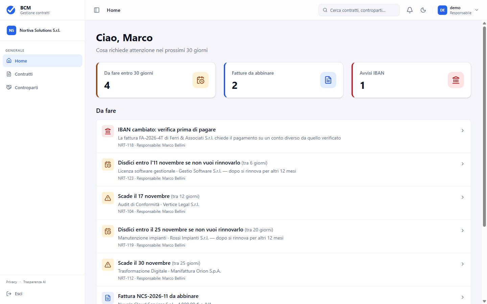
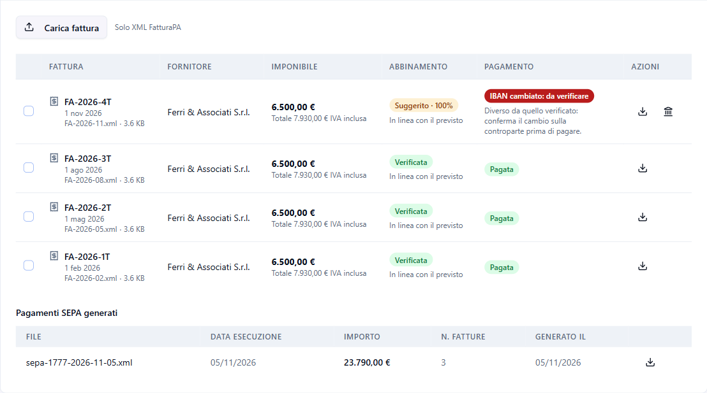
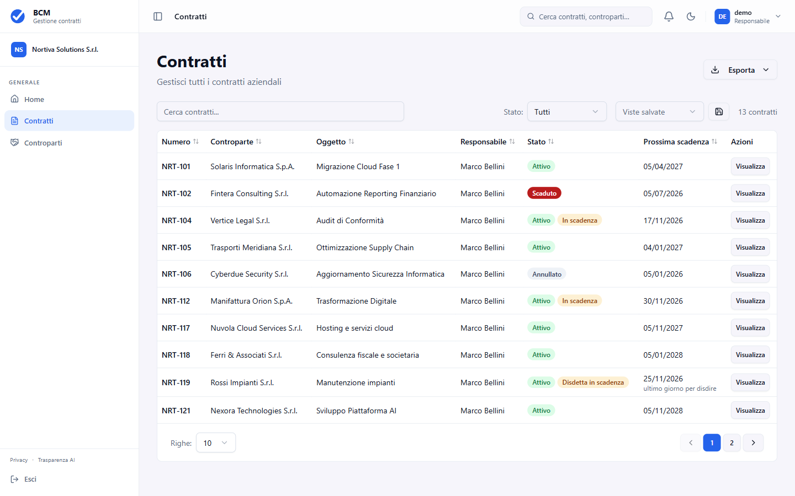
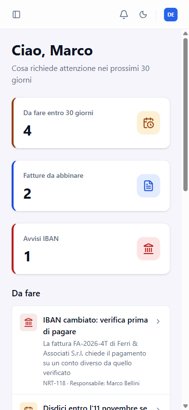
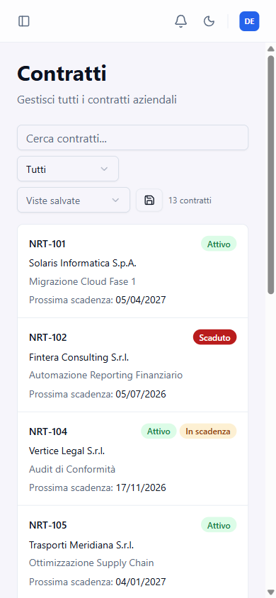
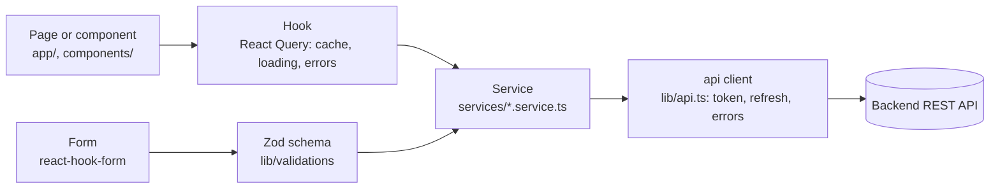
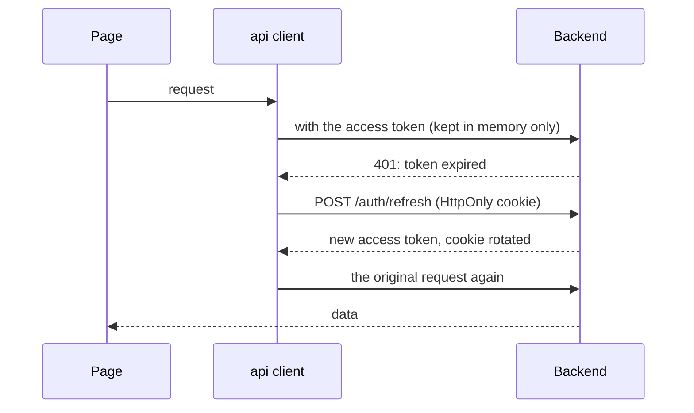

# BCM — Business Contracts Manager · Web app

> The web app of BCM: what to do about your contracts, today. Italian UI, for small and medium companies.
> The REST API, the architecture and the product story are in [bcm-v2-backend](https://github.com/DonatoCorbacioDev/bcm-v2-backend).

[](https://nextjs.org/)
[](https://react.dev/)
[](https://www.typescriptlang.org/)
[](#-quality)
[](./LICENSE)

**Live demo:** [bcm.donatocorbacio.dev](https://bcm.donatocorbacio.dev) — log in with `demo` / `BcmDemo#2026`.
**Author:** Donato Corbacio · donatocorbacio92@gmail.com · [LinkedIn](https://www.linkedin.com/in/donato-corbacio/)

---

## 📸 Screenshots

**Home — what needs attention in the next 30 days.** A changed IBAN first, then the last days to cancel a tacit renewal, contracts ending, invoices to match.



**A supplier invoice asking to be paid on a new bank account.** It can't be selected for the SEPA transfer until the change is confirmed on the supplier.



**Contracts, with the date to act on.** For a tacit renewal that's the last day to give notice, not the end date.



**On a phone.** The list becomes one card per contract; nothing important falls off the screen.

| Home | Contracts |
|---|---|
|  |  |

---

## ✨ What's in it

- **Home "Da fare"** — one list, in order of urgency: changed IBANs, notice deadlines, contracts ending, invoices to match; then this year's supplier invoices against expected costs
- **Contracts** — form with optional fields kept out of the way, tacit renewal with a live preview of the last day to give notice (and a check that the notice isn't longer than the contract), next-action card on every contract, history with who changed what
- **Invoices** — FatturaPA upload, match status, payment method (bank transfer, RiBa, direct debit…), SEPA file generation for what is paid by transfer
- **Counterparties** — customers and suppliers, verified IBAN, address filled in from the supplier's invoices
- **First-run setup** — business area, managers and first counterparty, so the first contract can be created right away
- **Account** — two-factor login, calendar feed of deadlines, data export and account deletion

Features that aren't reliable yet (semantic search, document AI, the old analytics dashboard) are behind flags and off: see [Configuration](#-configuration).

---

## 🏗️ How it's built

### From a page to the API



Server data lives in React Query, never copied into a global store; the only global state (Zustand) is who is logged in. Every form is validated by a Zod schema that mirrors the backend's rules, so a user sees the error before the request.

### Staying logged in



The access token is never written to `localStorage`. Requests that fail together share one refresh call instead of racing each other.

### Folders

```
app/            routes (App Router): (auth) login and registration, (dashboard) the app
components/     UI by area: contracts, dashboard, counterparties, onboarding, ui (shadcn/ui)
hooks/          React Query hooks and small helpers (useIsMobile...)
services/       one file per API resource
lib/            api client, Zod schemas, formatting (dates with Italian articles, money, addresses)
store/          Zustand: the authenticated user
__tests__/      Jest + Testing Library: unit, validations, integration of pages and forms
e2e/            Playwright, including automated accessibility checks
```

---

## ✅ Quality

| | |
|---|---|
| **Tests** | 1,300+ with Jest and Testing Library (`npm test`), pages and forms tested the way a user uses them |
| **End-to-end and accessibility** | Playwright with axe on the main pages (`npm run test:e2e`) |
| **Types and lint** | `npm run typecheck`, `npm run lint`, both clean |

Numbers change with every commit: the commands are the source of truth.

---

## ▶️ Run it

The easiest way is the whole stack with one `docker compose up`: see [bcm-v2-docker](https://github.com/DonatoCorbacioDev/bcm-v2-docker#-quick-start).

The frontend alone, against a running backend:

```bash
npm install
cp .env.example .env.local   # NEXT_PUBLIC_API_URL=http://localhost:8090/api/v1
npm run dev                   # http://localhost:3000
```

## 🔧 Configuration

| Variable | Default | What it does |
|---|---|---|
| `NEXT_PUBLIC_API_URL` | — | Backend base URL, e.g. `http://localhost:8090/api/v1` |
| `NEXT_PUBLIC_SITE_URL` | `https://bcm.donatocorbacio.dev` | Absolute URL for link previews (Open Graph) |
| `NEXT_PUBLIC_EXPERIMENTAL_AI` | off | Semantic search and document AI: not reliable enough yet |
| `NEXT_PUBLIC_HOME_ANALYTICS` | off | The former charts dashboard under the home page |

---

## 📖 For users

A short guide in Italian, the five things people do most: [docs/GUIDA-RAPIDA.md](./docs/GUIDA-RAPIDA.md).

---

**Donato Corbacio** — full-stack developer, freelance as DonatoLayer, based in Puglia, Italy.
📧 donatocorbacio92@gmail.com · 💼 [LinkedIn](https://www.linkedin.com/in/donato-corbacio/) · 🐱 [GitHub](https://github.com/DonatoCorbacioDev)

The author retains all commercial rights — see [LICENSE](./LICENSE).
